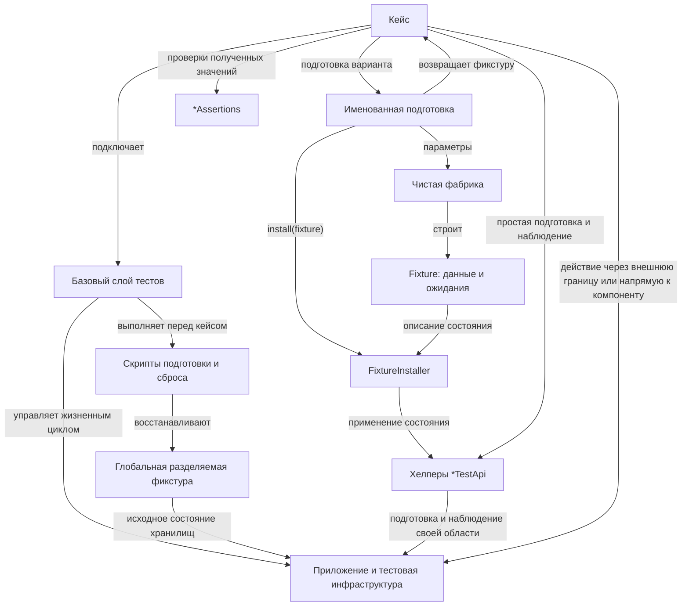

# Материал для статьи об общей архитектуре тестов

Из предыдущей версии `test-fixture-architecture.md` в Git; требует согласования с текущей архитектурной статьёй.

Граничные и компонентные тесты используют базовый слой, который управляет жизненным циклом приложения, тестовой инфраструктуры и глобальной разделяемой фикстуры.
Он подключает общую конфигурацию и средства подготовки, обеспечивает стандартное, детерменированноие и одинаковое для всех кейсов исходное состояние и освобождает временные ресурсы после него.
В зависимости от стэка и фреймворка, базовый слой может быть реализован базовым классом, расширением тестового фреймворка, общими обработчиками жизненного цикла теста и т. д..

Глобальная разделяемая фикстура — общее исходное наполнение хранилищ, требуемое для больше половины тестов.
Она устанавливается базовым слоем перед запуском любого тест-кейса.
Кейс переиспользует подходящие общие данные и добавляет только специфичное для него состояние.
Как правило, в глобальную разделяемую фикстуру попадает подготовка основных видов (ролей) пользователей системы, а так же несколько экземпляров ключевых типов сущностей.

`*TestApi` — типизированный тестовый хелпер подготовки и наблюдения состояния одного агрегата, ресурса или внешней системы.
Он скрывает обращения к продакшн-компонентам и предоставляет операции создания, изменения или удаления данных, настройки системы и получения её состояния в пределах своей области.
Для простой подготовки кейс вызывает `*TestApi` напрямую; для сложной чистая фабрика строит описание `Fixture`, а `FixtureInstaller` применяет его, координируя необходимые `*TestApi`.

После подготовки граничный тест выполняет проверяемое действие через типизированный хелпер внешней границы, например `*HttpApi`.
Этот хелпер вызывает реальную точку входа системы и скрывает транспортные детали от кейса.
Компонентный тест вызывает проверяемый компонент напрямую, сохраняя те же средства подготовки и наблюдения.

Кейс проверяет результат действия, а если нужно дополнительное наблюдение состояния — получает его через `*TestApi` соответствующей области.
Методы `*TestApi.verify...` могут объединять получение состояния и его проверку внутри этой области.
Переиспользуемые проверки уже полученных доменных значений размещаются в `*Assertions`, которые сами не обращаются к системе.

Тест чистого вычисления передаёт проверяемому коду локальные данные или результат чистой фабрики и сравнивает результат с ожиданием.
Базовый инфраструктурный слой, установщик и `*TestApi` ему не нужны.

