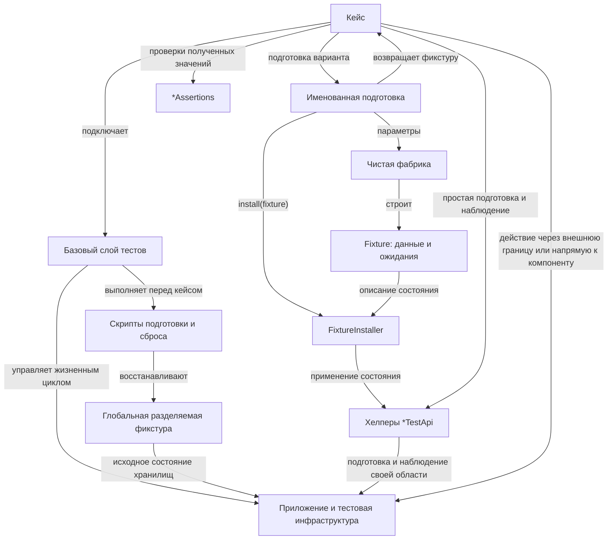

---
keywords:
  - tests
  - fixture-architecture
---

# Архитектура тестовых фикстур

## Общая архитектура

Граничные и компонентные тесты используют базовый слой, который управляет жизненным циклом приложения, тестовой инфраструктуры и глобальной разделяемой фикстуры.
Он подключает общую конфигурацию и средства подготовки, обеспечивает стандартное, детерменированноие и одинаковое для всех кейсов исходное состояние и освобождает временные ресурсы после него.
В зависимости от стэка и фреймворка, базовый слой может быть реализован базовым классом, расширением тестового фреймворка, общими обработчиками жизненного цикла теста и т. д..

Глобальная разделяемая фикстура — общее исходное наполнение хранилищ, требуемое для больше половины тестов.
Она устанавливается базовым слоем перед запуском любого тест-кейса.
Кейс переиспользует подходящие общие данные и добавляет только специфичное для него состояние.
Как правило, в глобальную разделяемую фикстуру попадает подготовка основных видов (ролей) пользователей системы, а так же несколько экземпляров ключевых типов сущностей.

`*TestApi` — типизированный тестовый хелпер подготовки и наблюдения состояния одного агрегата, ресурса или внешней системы.
Он скрывает обращения к продакшн-компонентам и предоставляет операции создания, изменения или удаления данных, настройки системы и получения её состояния в пределах своей области.
Для простой подготовки кейс вызывает `*TestApi` напрямую; для сложной чистая фабрика строит описание `Fixture`, а `FixtureInstaller` применяет его, координируя необходимые `*TestApi`.

После подготовки граничный тест выполняет проверяемое действие через типизированный хелпер внешней границы, например `*HttpApi`.
Этот хелпер вызывает реальную точку входа системы и скрывает транспортные детали от кейса.
Компонентный тест вызывает проверяемый компонент напрямую, сохраняя те же средства подготовки и наблюдения.

Кейс проверяет результат действия, а если нужно дополнительное наблюдение состояния — получает его через `*TestApi` соответствующей области.
Методы `*TestApi.verify...` могут объединять получение состояния и его проверку внутри этой области.
Переиспользуемые проверки уже полученных доменных значений размещаются в `*Assertions`, которые сами не обращаются к системе.

Тест чистого вычисления передаёт проверяемому коду локальные данные или результат чистой фабрики и сравнивает результат с ожиданием.
Базовый инфраструктурный слой, установщик и `*TestApi` ему не нужны.

## Базовый слой и разделяемая фикстура

- Запуск или подключение инфраструктуры, запуск приложения и инициализацию схем и других ресурсов выполняй в общем слое жизненного цикла с переиспользованием между кейсами.
- Перед каждым кейсом восстанавливай глобальную разделяемую фикстуру общими скриптами подготовки и сброса; создание схемы и наполнение тестовыми данными оставляй отдельными ответственностями.
- В этом же слое сбрасывай изменяемое состояние тестовых дублей и других зависимостей, а после кейса освобождай временные ресурсы его подготовки.
- В разделяемую фикстуру включай данные, нужные многим кейсам; состояние отдельного сценария описывай и устанавливай в его подготовке.
- Переиспользуй подходящие разделяемые данные вместо их повторного создания в кейсе.
- Выполнение общих скриптов относится к базовому слою; кейсы и установщики не должны брать на себя общий сброс инфраструктуры и разделяемой фикстуры.

## Границы хелперов

- Ограничивай `*TestApi` одним агрегатом, ресурсом или внешней системой.
- Если подготовке или наблюдению нужна другая область, используй или создай её собственный `*TestApi`.
- Размещай низкоуровневые переиспользуемые вызовы подготовки и наблюдения внутри области в `*TestApi`, а не в классах тестов.
- `*TestApi` может получать и проверять состояние своей области методами `verify...`.
- `*Assertions` не имеют состояния и работают только с доменными значениями, переданными вызывающей стороной; они не зависят от `*TestApi` или продакшн-компонентов для получения состояния.
- Оркестрацию подготовки нескольких агрегатов или ресурсов размещай в `*FixtureInstaller`, а не в `*TestApi`.
- Установщик может компоновать несколько `*TestApi`, чистые построители данных и средства настройки внешних систем.
- Не вводи компоненты-агрегаторы фикстур только ради упрощения внедрения зависимостей.

## Модель сложной фикстуры

Для сложной или повторяющейся подготовки разделяй описание состояния, построение данных и установку состояния.
Для нескольких простых значений достаточно локальных данных теста.

| Роль | Ответственность | Побочные эффекты |
| --- | --- | --- |
| `<Subject>Fixture` | Описывает необходимые данные, связи, настройки, параметры запроса и ожидания случая. | Нет. |
| Каноническая фабрика | Строит согласованный именованный вариант `Fixture`. | Нет. |
| `<Subject>FixtureInstaller.install(fixture)` | Применяет переданное описание к системе и тестовому окружению. | Да. |
| Именованная подготовка `setup…` | Передаёт параметры канонической фабрике, вызывает `install(fixture)` и возвращает фикстуру. | Через установщик. |
| `<Entity>Spec` | Описывает параметры отдельной сущности внутри фикстуры; выделяется при необходимости. | Нет. |

- Задавай ожидания по требованию к поведению, независимо от результата проверяемого кода.
- Называй фабрики по гарантируемому состоянию и передавай значимые различия параметрами.
- Установщик использует переданную фикстуру; варианты данных и их ожидания определяют фабрики.
- Установка может создавать, изменять и удалять данные, настраивать связи, кэши, моки и внешние системы.
- В тесте с инфраструктурой используй именованную подготовку либо явно вызови фабрику и `install(fixture)`.
- В тесте вычислений используй ту же чистую фабрику без установщика и инфраструктуры.
- Проверяемое действие и сравнение результата с ожиданием выполняй в тесте после подготовки.
- Применяй модель к новой или изменяемой подготовке; не требуй массового переименования существующего кода без отдельного запроса пользователя.

## Выбор и расширение подготовки

- Сначала найди подходящую фикстуру, каноническую фабрику и именованную подготовку; переиспользуй готовый вариант.
- Для нового набора значений добавь фабрику; сохрани установщик, если состав описания и способ установки не изменились.
- Если состоянию нужны дополнительные сведения, дополни модель и согласуй фабрики; если нужны новые эффекты, дополни установщик.
- В именованной подготовке оставляй только вызовы фабрики и установки; повторяющуюся подготовку оформляй отдельным именованным вариантом.
- Для самостоятельной области подготовки выделяй свои `Fixture` и `FixtureInstaller`; несколько фикстур можно явно скомпоновать в тесте.

## Проверка границ

- Перед проектированием нового метода изучи существующие хелперы и их использования.
- Переиспользуй общий метод подготовки, если выбранное поведение не различает конкретный подтип данных.
- Называй метод по действию или наблюдаемому состоянию, не повторяя область владельца и не раскрывая устройство хранения, если выбранное поведение его не различает.
- Перед добавлением или изменением `*TestApi` назови его агрегат или ресурс.
- Если метод получает данные из другой области, перенеси это чтение в её `*TestApi`.
- Если метод создаёт, связывает или изменяет объекты нескольких областей, перенеси оркестрацию в `*FixtureInstaller`.
- Методы вида `createXForY`, `addXToY`, `bindXToY` или `attachXToY` относятся к установщику, если `X` и `Y` не находятся внутри одного агрегата или ресурса.
- Зависимости конструктора `*TestApi` от репозиториев, клиентов или API нескольких областей нарушают его границу.
- Не объединяй наблюдения нескольких областей в специальный контейнер ради проверки; оставляй отдельные вызовы `*TestApi.verify...`.

## Использование в кейсе

- В кейсе при подготовке и наблюдении обращайся к продакшн-репозиториям, DAO, сервисам, клиентам и другим компонентам с состоянием только через `*TestApi` соответствующей области.
- Не внедряй эти продакшн-зависимости в класс теста для подготовки или наблюдения.
- При планировании такого доступа назови существующий `*TestApi` или запланируй его создание; продакшн-зависимость упоминай только как деталь реализации.
- Прямые вызовы `*TestApi` используй для простой подготовки или наблюдения; связанную сложную подготовку выражай фикстурой и установщиком.
- Внедряй только необходимые классу тестов хелперы фикстур.
