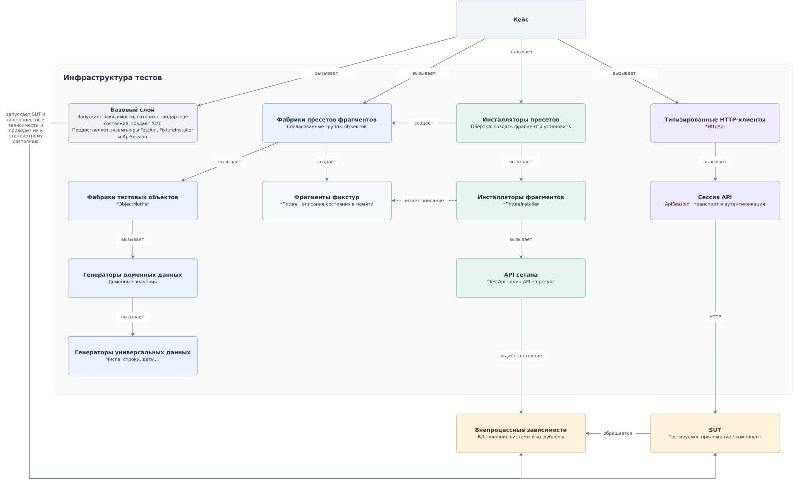

---
keywords:
  - tests
  - fixture-architecture
---

# Эргономичная архитектура: код подготовки фикстуры кейсов

Эта статья описывает архитектуру кода подготовки фикстуры кейсов в Эргономичном подходе.
Она описывает общие требования к такому коду, список типовых видов кода и связи между ними.
Вся эта информация даёт вам интуицию решения каких проблем вам надо искать уже готовыми в существующей инфраструктуре и как её дополнить, если для вашей проблемы решения ещё нет.

## В чём вообще проблема

Любому кейсу для своей работы требуется как минимум две единицы данных — аргумент, с которыми он вызовет тестируемый код и результат, который должен получиться в результате вызова.
Для функции вычисления квадратного корня это будет просто два дробных числа.

Но даже для чистых функций могут потребоваться намного более сложные структуры данных: например, функция расчёта стоимости заказа может требовать на вход список товаров, адрес доставки, тарифный план заказчика и историю его заказов.

А в [граничном кейсе](test-design.md#тесты-внешней-границы) на размещение заказа, который включает расчёт его стоимости, все эти данные надо не только подготовить, но и разложить по хранилищам данных (с учётом ограничений целостности) и внешним системам.
Которые ещё и должны быть запущенны, предварительно.
Вместе с собственно тестируемым приложением.

В результате, объём кода, требуемого, для подготовки всего этого — фикстуры кейса — зачастую в разы больше всего остального кода кейса.
А в крайних случаях, код подготовки фикстуры кейса может быть в разы больше остального тестового и тестируемого кода вместе взятых.
В результате чего, в свою очередь, написание и поддержка кода сетапа фикстуры граничных тестов может занимать львиную долю от всех трудозатрат на автоматизацию тестирования.
И это проблема.

И так как оставаясь в рамках Эргономичного подхода мы не можем применить к этой проблеме метод Сталина (нет тестов — нет проблем), то нам остаётся только научиться писать код подготовки фикстуры максимально эффективно.

Архитектура кода подготовки фикстуры кейсов в Эргономичном подходе — это квинтэссенция моих 6 лет практики написания граничных тестов и подготовки фикстуры для них, удовлетворяющих требованиям Эргономичного подхода.

## Требования к решению

Требования к решению задачи подготовки фикстуры кейса продиктованы общими требованиями ЭП к тестам:

1. Инфраструктура подготовки фикстуры должна позволять тестировать весь рабочий код, включая код интеграции с внешними зависимостями.
2. Совокупные трудозатраты на написание и поддержку кейсов и самой инфраструктуры подготовки фикстуры должны быть минимальными.
3. Код подготовки фикстуры должен максимизировать отношение сигнал / шум в коде кейсов.
   В частности, кейс должен иметь возможность описать требуемое состояние системы на языке домена, указав **только** значения и состояние, существенные для проверяемого сценария.
4. Инфраструктура подготовки фикстуры должна изолировать код кейсов от деталей реализации рабочего кода, чтобы минимизировать количество изменений в тестах при его рефакторинге — в идеале до нуля.
5. Подготовка фикстуры должна укладываться в общий временной бюджет теста, оставляя достаточно времени на выполнение тестируемого кода и верификацию.

Наверное, существует множество подходов, которые направляют разработку к созданию такого кода.
Но мне не удалось найти описания хотя бы просто целостного и современного (не говоря уж о согласованности с требованиями ЭП) архитектурного подхода к коду сетапа фикстур, поэтому пришлось изобрести свой.

## Решение

В основе Эргономичной архитектуры тестов (ЭАТ) лежат классические [xUnit Patterns](http://xunitpatterns.com/) и другие устоявшиеся практики тестирования:

1. Разделение кейса на части Given/When/Then aka Arrange/Act/Assert.
2. Применение стандартной фикстуры.
3. Использование различных тестовых хелперов для написания кода кейсов в терминах домена.
4. Активное применение генераторов случайных данных.
5. Активное применение фабрик тестовых объектов (комбинации Object Mother и Test Data Builder).

Но в ЭАТ эти практики обросли своими идиомами, особенностями и спецификой, частично обусловленными её фокусом на тестировании бэкендов на Kotlin, Spring и Postgres с помощью JUnit, а частично сложившимися просто стихийно:

1. Генераторы случайных данных на два типа:
  1. Базовые генераторы универсальных данных (числа, даты, строки, емейлы и т.п.).
     В качестве базового генератора обычно используется готовая библиотека, например [Datafaker](https://www.datafaker.net/).
  2. Поверх базовых генераторов строятся уже генераторы простых доменных данных — не просто строка, а название упражнения, например, или не просто дата, реально возможная дата рождения пользователя системы.
     Плюс сюда же входят генераторы доменных объектов-значений, для которых нет однозначной сущности-владельца.
2. Фабрики тестовых объектов:
  1. По духу ближе к [Test Data Builders](http://www.natpryce.com/articles/000714.html) Нэта Прайса, но в коде называются ObjectMother-ами, чтобы дистанцироваться от генераторов случайных данных.
  2. За один вызов генерируют только один объект.
  3. Но один класс фабрики может предоставлять методы для создания объектов множества связанных типов - как правило, сущность и всё что связано только с ней: объекты значения, ДТО запросов и ответов связанных с этой сущностью и т.п.
3. Классы хелперов изменения состояния SUT-а и его зависимостей называются TestApi и привязаны к [ресурсам](../ergonomic-architecture/ergonomic-component-structure.md#terminology) — один `<Resource>TestApi` скрывает работу с одним ресурсом `Resource`.

Помимо этого в ЭАТ есть и менее известные и распространённые элементы:

1. Фрагменты фикстур, фабрики пресетов фрагментов, инсталляторы фрагментов и инсталляторы пресетов.
   Фрагмент фикстуры — это группа разнородных объектов в памяти, которая описывает состояние внепроцессных зависимостей SUT-а и может также содержать связанные с ним параметры вызова SUT-а и ожидаемые значения.
   Это позволяет хранить вместе согласованные данные для подготовки, вызова и проверки, когда такое объединение упрощает код кейса.

   Фабрика пресета фрагмента фикстуры — это функция, которая формирует экземпляры фрагментов, имеющих определённые свойства, например пользователь с 3 заказами заданного товара.

   Инсталляторы фрагментов фикстур — это в свою очередь процедуры приведения зависимостей SUT-а к состоянию, описанному фрагментом.

   Инсталляторы пресетов фрагментов фикстур - это просто обёртка для удобства вокруг вызова фабрики и предачи полученного фрагмента сразу в инсталлятор.

2. Сессии API и типизированные HTTP-клиенты для граничных тестов HTTP-эндпоинтов.
   Сессия API — это инкапсулированный механизм выполнения HTTP-запросов и опциональные данные аутентификации этих запросов.

   Типизированных HTTP-клиент — это "переводчик" с доменного языка на язык HTTP и обратно, использующий сессию API для выполнения запросов к определённой группе связанных эндпоинтов.

В результате полный перечень типовых элементов фикстурного слоя следующий:

1. Генераторы униварсальных данных.
2. Генераторы доменных данных.
3. Фабрики тестовых данных (`*ObjectMother`).
4. Фрагменты фикстуры (`*Fixture`).
5. Фабрики пресетов фрагментов фикстуры.
6. API сетапа фикстуры (`*TestApi`).
7. Инсталляторы фрагментов фикстуры (`*FixtureInstaller`).
8. Инсталляторы пресетов фрагментом фикстуры.
8. Сессия API (`ApiSession`).
9. Типизированный HTTP Client ('*Api');
10. Базовый слой.

И в ЭАТ это всё собирается в единую инфраструктуру кодирования кейсов:

1. Базовый слой:
    1. Запускает общие внепроцессные зависимости.
    2. Приводит общие зависимости к стандартному состоянию.
    3. Создаёт экземпляр SUT-а.
    4. Предоставляет кейсу API для получения TestApi, FixtureInstaller-ов и ApiSession-ов.
2. Генераторы случайных универсальных, доменных данных, TestDataBuilder-ы и фабрики фрагментов фикстур предоставляют кейсу API для:
    1. формирования описания состояния зависимостей.
    2. формирования параметров вызова SUT-а.
    3. формирования ожидаемых значений результата вызова SUT-а, состояния SUT-а и обращений к внешним системам.
3. TestApi и FixtureInstaller-ы дают кейсу API для приведения зависимостей к требуемому состоянию.
4. ApiSession-ы и HTTP-клиенты предоствляют кейсу API для обращения к SUT-у в терминах домена.

Концептуально вся эта конструкция выглядит так:

Важно отметить, что это открытая архитектура: кейс может свободно комбинировать обращения к любым нижележащим элементам.
Все элементы архитектуры являются необязательными и применяются, только когда от них есть польза:

* Тесту чистой функции вообще не нужен базовый слой — он может напрямую сгенерировать нужные параметры SUT-а и вызвать его непосредственно.
* Компонентному тесту не нужен HTTP-клиент для взаимодействия с SUT-ом.
* Простому компонентному кейсу создания независимой сущности нужен только SUT и параметры для его вызова, а TestApi и Fixture/FixtureInstaller-ы — нет.
* А простому компонентному кейсу обновления независимой сущности дополнительно потребуется только хелпер для создания изначального экземпляра сущности — городить фрагмент фикстуры и её инсталлятор только ради архитектурной чистоты не надо.
