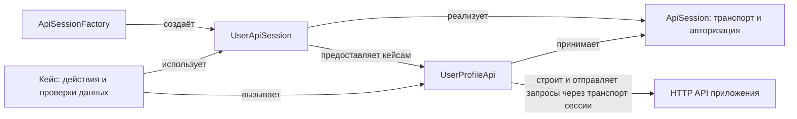

# Сессии тестовых HTTP-клиентов

Граничный тест HTTP API должен вызывать приложение через HTTP, но сам кейс должен быть написан как сценарий пользователя: войти в систему, получить профиль, проверить его данные.
Если каждый кейс самостоятельно собирает URL и заголовки, сериализует запрос и разбирает ответ, транспортный код заслоняет проверяемое поведение.
Чтобы это предотвратить, нужна тестовая обвязка, которая переводит доменные действия в HTTP-вызовы и возвращает типизированные результаты.

От этой обвязки требуется сохранить реальные вызовы HTTP-границы и проверки её контракта, убрать транспортные детали из кейсов и позволить независимо выбирать операцию и пользователя, от имени которого она выполняется.
Последнее нужно и для обычных сценариев, и для проверки прав: например, попытки вызвать административную операцию с авторизацией обычного пользователя.

## Как разделить код

- **Доменный API**, например `UserProfileApi`, — класс тестовой обвязки с методами вроде `getProfile()`.
  Он строит и отправляет HTTP-запросы, проверяет статус и схему ответа, декодирует тело и возвращает типизированный результат.
  Кейс вызывает этот класс и проверяет значимые для сценария данные.
- **`ApiSession`** — контейнер настроенного HTTP-транспорта и данных авторизации, если они нужны приложению.
  Доменный API принимает сессию и использует её при выполнении запросов.
- **Специализированная сессия**, например `UserApiSession`, — представление сессии участника сценария с определённой ролью.
  Оно помогает ограничить доступ только к его доменным API средствами выбранного языка, но само не выполняет операции и не гарантирует права на сервере.
- **`ApiSessionFactory`** инкапсулирует в себе конкретный транспортный механизм, способ аутентификации запросов и способ создания сессии с настроенным транспортом и нужной авторизацией, используя проектный механизм входа.
  Так кейсы получают участника сценария без повторения настройки HTTP-клиента и процедуры авторизации.

## Правила реализации

Внутри доменного API для каждого эндпоинта оставь один построитель низкоуровневого запроса `*ForResponse`; метод успеха делегирует ему, проверяет статус и схему ответа, затем декодирует тело доменный тип.
Для ожидаемой ошибки создавай `*ForError`, который работает аналогично методу успеха, но декодирует тело ответа в доменный тип ошибки.
А для вызовов, которые могут завершиться и успехом и ошибкой (для недетерменированных тестов, как правило) — создавай `*ForOutcome`.

Избегай перечисления всех доступных доменных API в классах специализированных сессий, так как это приведёт к их бесконечному росту
Обеспечивай возможность создавать доменные API с произвольными сессиями, для того чтобы можно было тестировать поведение API при попытках доступа с некорректными данными авторизации.
Для удобства старайся предоставить простой способ для перехода от одного типа специализированной сессии к другому, с сохранением транспорта и данных авторизации.